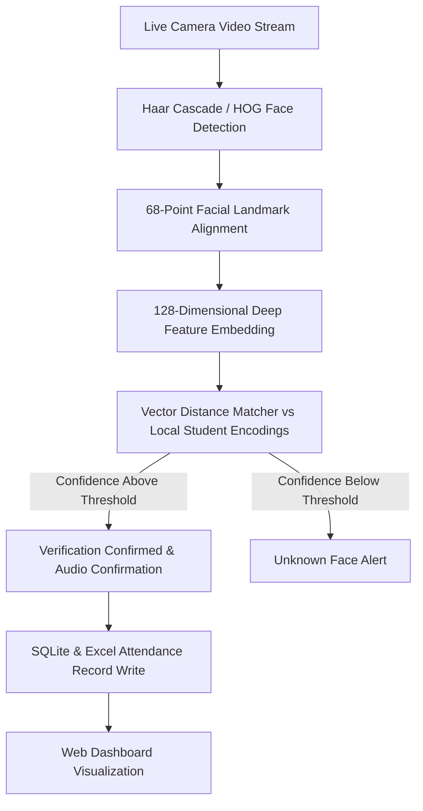

<div align="center">

<h1>Smart Biometric Attendance Verification System</h1>


<p><strong>Real-Time Facial Recognition Attendance Management System with Anti-Spoofing Architecture</strong></p>

<p>
  <a href="https://skillicons.dev"></a>
</p>

</div>

---

## Executive Summary

The Smart Biometric Attendance Verification System replaces manual record-keeping with automated computer vision authentication. Utilizing 128-dimensional facial embedding vectors and Euclidean distance comparison, the system identifies individuals in real time, prevents duplicate registrations, logs arrival timestamps, and compiles automated Excel reports.

---

## System Interface & Verification Gallery

<table align="center">
  <tr>
    <td align="center"><b>Real-Time Facial Detection Interface</b><br><sub>Spatial landmark tracking with confidence bounding boxes.</sub></td>
    <td align="center"><b>Biometric Identity Verification</b><br><sub>Instantaneous candidate verification against encoded face database.</sub></td>
  </tr>
  <tr>
    <td align="center"></td>
    <td align="center"></td>
  </tr>
  <tr>
    <td align="center"><b>Automated Attendance Timestamp Log</b><br><sub>Immutable attendance session logging and daily attendance records.</sub></td>
    <td align="center"><b>Student Registration & Management</b><br><sub>Enrollment portal for capturing training image sets.</sub></td>
  </tr>
  <tr>
    <td align="center"></td>
    <td align="center"></td>
  </tr>
</table>

---

## System Architecture



---

## Technology Stack

| Domain | Technologies |
| :--- | :--- |
| Vision Frameworks | OpenCV, Face Recognition, Dlib |
| Core Language | Python 3.10+ |
| Web Application | Flask, HTML5, CSS3, JavaScript |
| Data Export | Pandas, OpenPyXL |

---

## Installation & Setup

```bash
# Clone the repository
git clone https://github.com/sohailahmed-bsrh/smart-attendance-system.git
cd smart-attendance-system

# Install dependencies
pip install -r requirements.txt

# Encode student face database
python encode_faces.py

# Launch attendance verification system
python main.py
```

---

## Author & License

- **Author**: Sohail Ahmed ([Portfolio](https://sohail.devsil.com) | [GitHub](https://github.com/sohailahmed-bsrh))
- **License**: Distributed under the MIT License.
