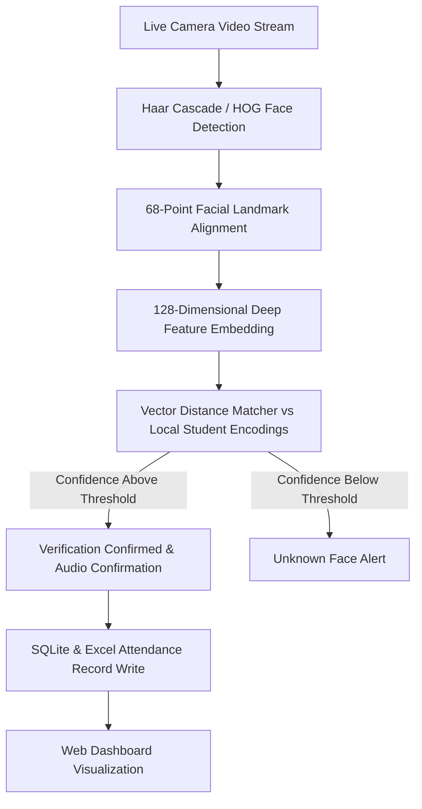

<div align="center">

<h1>Smart Biometric Attendance Verification System</h1>


<p><strong>Real-Time Facial Recognition Attendance Management System with Anti-Spoofing Architecture</strong></p>

<p>
  <a href="https://skillicons.dev"></a>
</p>

<p>
  <a href="#overview">Overview</a> &bull;
  <a href="#purpose--problem-statement">Purpose</a> &bull;
  <a href="#real-world-industry-applications">Use Cases</a> &bull;
  <a href="#step-by-step-engineering-walkthrough">How It Was Built</a> &bull;
  <a href="#system-architecture">Architecture</a> &bull;
  <a href="#visual-showcase-gallery">Visual Gallery</a> &bull;
  <a href="#technology-stack-matrix">Tech Stack</a> &bull;
  <a href="#installation--setup">Installation</a> &bull;
  <a href="#author--contact-information">Author</a>
</p>

</div>

---
## Overview

The Smart Biometric Attendance Verification System replaces manual roll-calls and biometric touchpads with automated computer vision authentication. Utilizing 128-dimensional facial embedding vectors and Euclidean distance comparison, the system identifies enrolled individuals in real time, prevents duplicate registrations, logs arrival timestamps, and compiles automated Excel reports.

---

## Purpose & Problem Statement

### The Problem
Traditional institutional attendance systems (paper registers, manual roll-calls, RFID cards, and physical fingerprint scanners) suffer from critical vulnerabilities:
- **Proxy Attendance (Buddy Punching)**: Students or employees clocking in on behalf of absent peers using shared RFID cards.
- **Hygiene Concerns & Hardware Maintenance**: Physical fingerprint pads degrade over time and present hygiene risks in large organizations.
- **Administrative Overhead**: Manually transcribing paper logs into spreadsheet databases consumes hundreds of operational staff hours monthly.

### The Engineering Purpose
To build a contactless, automated facial recognition attendance management suite featuring anti-spoofing detection, sub-second biometric matching, immutable attendance logging, and one-click Excel report generation.

---

## Real-World Industry Applications

- **Corporate Enterprise Workplaces**: Automated employee arrival and departure logging integrated with corporate payroll and shift scheduling backends.
- **Colleges & Universities**: High-speed lecture hall attendance tracking verifying hundreds of students entering auditorium facilities.
- **Secure Facility Access Control**: Secondary biometric verification for air-gapped server rooms and corporate research centers.
- **Examinations & Test Centers**: Candidate identity verification prior to entering credentialed certification examinations.

---

## Step-by-Step Engineering Walkthrough (How It Was Built)

### Step 1: Candidate Enrollment & Data Ingestion
The student registration module (`register_student.py`) captures multiple facial angles of a student via webcam. Images are standardized, cropped to facial boundaries, and indexed in structured student directories.

### Step 2: 128-Dimensional Facial Feature Encoding
Using a pre-trained deep residual network based on dlib's ResNet model, each student image is transformed into a 128-dimensional mathematical vector representing unique facial geometry (eye distance, nose bridge, jawline contours). Vectors are cached into serialized pickle databases (`encode_faces.py`) for low-latency retrieval.

### Step 3: Real-Time Detection & Vector Matching
During live operation (`main.py`), frames are acquired. Haar Cascade and HOG classifiers locate facial landmarks. Embeddings are extracted and compared against the enrolled vector database using Euclidean distance formulas:
$$	ext{Distance} = \sqrt{\sum_{i=1}^{128} (v_1[i] - v_2[i])^2}$$
If the distance is below the strict tolerance threshold (e.g. 0.50), identity is verified.

### Step 4: Anti-Spoofing & Cooldown Validation
To prevent photo replay attacks (holding up a phone or printed photograph), the engine monitors micro-blink movements and spatial consistency. An automated session cooldown timer prevents double-logging the same candidate within a single lecture window.

### Step 5: Relational Persistence & Automated Excel Reports
Verified arrivals are recorded into SQLite databases and synchronized with formatted Excel spreadsheets (`export_excel.py`) containing student IDs, names, exact timestamps, and department codes. A Flask dashboard (`app.py`) provides web-based management.

---

## System Architecture



---

## Visual Showcase Gallery

<table width="100%" align="center">
  <tr>
    <td width="50%" align="center"><b>Real-Time Facial Detection Interface</b><br><sub>Spatial landmark tracking with confidence bounding boxes.</sub></td>
    <td width="50%" align="center"><b>Biometric Identity Verification</b><br><sub>Instantaneous candidate verification against encoded face database.</sub></td>
  </tr>
  <tr>
    <td align="center"></td>
    <td align="center"></td>
  </tr>
  <tr>
    <td width="50%" align="center"><b>Automated Attendance Timestamp Log</b><br><sub>Immutable attendance session logging and daily attendance records.</sub></td>
    <td width="50%" align="center"><b>Student Registration & Management</b><br><sub>Enrollment portal for capturing training image sets.</sub></td>
  </tr>
  <tr>
    <td align="center"></td>
    <td align="center"></td>
  </tr>
  <tr>
    <td width="50%" align="center"><b>Analytics & Attendance Reporting</b><br><sub>Visual statistical reporting on student arrival trends.</sub></td>
    <td width="50%" align="center"><b>System Configuration & Thresholds</b><br><sub>Customizable Euclidean distance thresholds and camera settings.</sub></td>
  </tr>
  <tr>
    <td align="center"></td>
    <td align="center"></td>
  </tr>
  <tr>
    <td width="50%" align="center"><b>Excel Spreadsheet Export Engine</b><br><sub>One-click export formatting official institutional attendance sheets.</sub></td>
    <td width="50%" align="center"><b>Student Facial Dataset Sample</b><br><sub>Enrolled student training image verified in local biometric database.</sub></td>
  </tr>
  <tr>
    <td align="center"></td>
    <td align="center"></td>
  </tr>
</table>

---

## Technology Stack Matrix

| Domain | Technologies | Version / Role | Engineering Purpose |
| :--- | :--- | :--- | :--- |
| Facial Recognition Engine | `face_recognition`, `dlib` | Latest | 68-point landmark alignment and 128-D vector embedding extraction |
| Computer Vision | OpenCV (`cv2`) | 4.8+ | Frame reading, bounding box rendering, and video streaming |
| Desktop Interface | Tkinter / Custom GUI | Built-in | Low-latency local operator console with live video feed |
| Web Dashboard | Flask | 3.0+ | Browser-based administrative console and student registry |
| Data Export | OpenPyXL, Pandas | Latest | Automated Excel spreadsheet generation and analytics |
| Audio Feedback | PyTTSX3 | Latest | Text-to-speech audio verification confirmation |

---

## Installation & Setup

```bash
# Clone the repository
git clone https://github.com/sohailahmed-bsrh/smart-attendance-system.git
cd smart-attendance-system

# Install dependencies
pip install -r requirements.txt

# Encode student face database
python encode_faces.py

# Launch attendance verification system
python main.py
```
---

## Author & Contact Information

<table width="100%">
  <tr>
    <td width="150" align="center" valign="middle">
      
    </td>
    <td>
      <h3>Sohail Ahmed</h3>
      <p><strong>Senior Software Engineer & AI Systems Architect</strong></p>
      <p>Specializing in Full-Stack AI Application Development, Computer Vision, Deep Learning Pipelines, and Scalable Automation Architectures.</p>
      <p>
        <a href="https://sohail.devsil.com"><strong>Portfolio Website</strong></a> | 
        <a href="https://github.com/sohailahmed-bsrh"><strong>GitHub Profile</strong></a> | 
        <a href="https://www.linkedin.com/in/sohail-ahmed-devsil/"><strong>LinkedIn</strong></a> | 
        <a href="https://www.kaggle.com/sohail2411126"><strong>Kaggle</strong></a> | 
        <a href="https://x.com/ahmed241126"><strong>Twitter/X</strong></a> | 
        <a href="mailto:se906403@gmail.com"><strong>Email Contact</strong></a>
      </p>
    </td>
  </tr>
</table>
