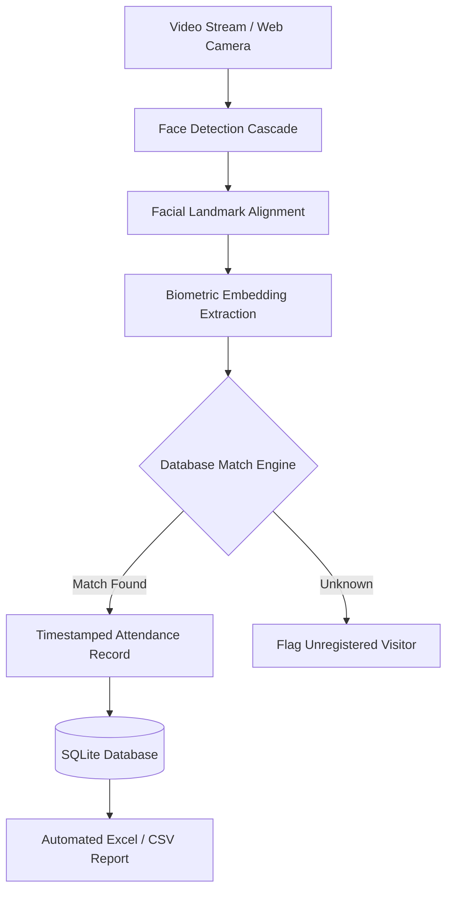

# Smart Attendance Tracking System

> Automated facial recognition pipeline for real-time identity verification and attendance logging.

[](https://github.com/sohailahmed-bsrh/smart-attendance-system)
[](https://sohail.devsil.com/projects.html)
[](https://sohail.devsil.com)

---

## Overview

Manual attendance taking in institutional and corporate environments incurs significant administrative overhead, human logging error, and vulnerability to proxy attendance.

This project provides an end-to-end, reproducible implementation engineered to solve this challenge through verified data transformations, reliable algorithms, and production-ready architecture.

---

## Key Features

- Real-time facial detection and 128-dimensional biometric embedding extraction using OpenCV and dlib
- Cosine similarity and Euclidean distance matching against an enrolled employee database
- Automatic timestamped check-in and check-out tracking stored in SQLite with Excel reporting
- Live desktop GUI for enrollment, stream preview, and automated analytics

---

## System Architecture



---

## Technology Stack

| Technology | Version / Spec | Role in Architecture |
| :--- | :--- | :--- |
| **OpenCV** | `4.8+` | Real-time frame capture, preprocessing, and bounding box rendering |
| **dlib / face_recognition** | `1.3+` | Facial landmark landmarking and 128-d vector embedding generation |
| **Python** | `3.10+` | Core execution runtime and business logic orchestration |
| **SQLite3** | `Built-in` | Local persistent storage for records, timestamps, and employee profiles |
| **Tkinter / PyQt** | `Built-in` | Administrative desktop control interface |

---

## Repository Structure

```text
smart-attendance-system/
|-- src/
|   |-- attendance_system.py
|   |-- encode_faces.py
|   |-- analytics.py
|   |-- export_excel.py
|   |-- gui.py
|   `-- config.py
|-- data/
|   |-- faces/
|   `-- attendance.db
|-- .gitignore
|-- requirements.txt
`-- README.md
```

---

## Installation and Execution

### Prerequisites
- Python 3.10 or higher
- Git version control
- Virtual environment manager (`venv`)

### Setup Instructions
1. Clone the repository:
```bash
git clone https://github.com/sohailahmed-bsrh/smart-attendance-system.git
cd smart-attendance-system
```

2. Configure environment and dependencies:
```bash
python -m venv venv
source venv/bin/activate  # On Windows: venv\Scripts\activate
pip install -r requirements.txt
python encode_faces.py
python app.py
```

---

## Interface and Verification
The system produces verifiable execution logs, prediction matrices, or interactive browser interfaces depending on the target mode. Verify operation by executing the commands specified above or inspecting the demonstration notebooks.

---

## Author and Contact
Developed by **Sohail Ahmed** — Full Stack AI Engineer & Machine Learning Specialist.
- **Portfolio:** [sohail.devsil.com](https://sohail.devsil.com)
- **GitHub:** [@sohailahmed-bsrh](https://github.com/sohailahmed-bsrh)
- **Email:** [sohail.bsrh@gmail.com](mailto:sohail.bsrh@gmail.com)
