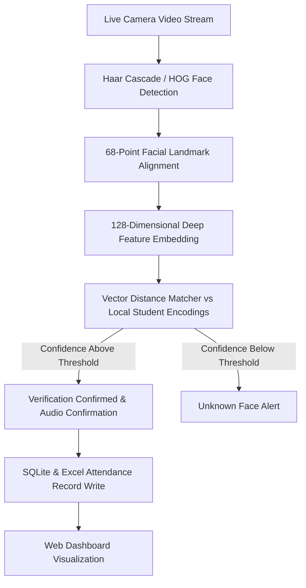

<div align="center">

<h1>Smart Biometric Attendance Verification System</h1>


<p><strong>Real-Time Facial Recognition Attendance Management System with Anti-Spoofing Architecture</strong></p>

<p>
  <a href="https://skillicons.dev"></a>
</p>

<p>
  <a href="#overview">Overview</a> &bull;
  <a href="#system-architecture">Architecture</a> &bull;
  <a href="#visual-showcase-gallery">Visual Gallery</a> &bull;
  <a href="#core-capabilities">Capabilities</a> &bull;
  <a href="#installation--setup">Installation</a> &bull;
  <a href="#author--contact-information">Author</a>
</p>

</div>

---
## Overview

The Smart Biometric Attendance Verification System replaces manual record-keeping with automated computer vision authentication. Utilizing 128-dimensional facial embedding vectors and Euclidean distance comparison, the system identifies individuals in real time, prevents duplicate registrations, logs arrival timestamps, and compiles automated Excel reports.

---

## Visual Showcase Gallery

<table width="100%" align="center">
  <tr>
    <td width="50%" align="center"><b>Real-Time Facial Detection Interface</b><br><sub>Spatial landmark tracking with confidence bounding boxes.</sub></td>
    <td width="50%" align="center"><b>Biometric Identity Verification</b><br><sub>Instantaneous candidate verification against encoded face database.</sub></td>
  </tr>
  <tr>
    <td align="center"></td>
    <td align="center"></td>
  </tr>
  <tr>
    <td width="50%" align="center"><b>Automated Attendance Timestamp Log</b><br><sub>Immutable attendance session logging and daily attendance records.</sub></td>
    <td width="50%" align="center"><b>Student Registration & Management</b><br><sub>Enrollment portal for capturing training image sets.</sub></td>
  </tr>
  <tr>
    <td align="center"></td>
    <td align="center"></td>
  </tr>
  <tr>
    <td width="50%" align="center"><b>Analytics & Attendance Reporting</b><br><sub>Visual statistical reporting on student arrival trends.</sub></td>
    <td width="50%" align="center"><b>System Configuration & Thresholds</b><br><sub>Customizable Euclidean distance thresholds and camera settings.</sub></td>
  </tr>
  <tr>
    <td align="center"></td>
    <td align="center"></td>
  </tr>
  <tr>
    <td width="50%" align="center"><b>Excel Spreadsheet Export Engine</b><br><sub>One-click export formatting official institutional attendance sheets.</sub></td>
    <td width="50%" align="center"><b>Student Facial Dataset Sample</b><br><sub>Enrolled student training image verified in local biometric database.</sub></td>
  </tr>
  <tr>
    <td align="center"></td>
    <td align="center"></td>
  </tr>
</table>

---

## System Architecture



---

## Technology Stack

| Domain | Technologies |
| :--- | :--- |
| Vision Frameworks | OpenCV, Face Recognition, Dlib |
| Core Language | Python 3.10+ |
| Web Application | Flask, HTML5, CSS3, JavaScript |
| Data Export | Pandas, OpenPyXL |

---

## Installation & Setup

```bash
# Clone the repository
git clone https://github.com/sohailahmed-bsrh/smart-attendance-system.git
cd smart-attendance-system

# Install dependencies
pip install -r requirements.txt

# Encode student face database
python encode_faces.py

# Launch attendance verification system
python main.py
```
---

## Author & Contact Information

<table width="100%" align="center">
  <tr>
    <td align="center" style="padding: 20px;">
      <h3>Sohail Ahmed</h3>
      <p><strong>Full-Stack Artificial Intelligence & Computer Vision Engineer</strong></p>
      <p>
        <a href="https://sohail.devsil.com"></a>
        <a href="https://github.com/sohailahmed-bsrh"></a>
        <a href="https://linkedin.com/in/sohail-ahmed-dev"></a>
        <a href="mailto:sohail.bsrh@gmail.com"></a>
      </p>
      <p><em>Available for technical roles in Artificial Intelligence, Computer Vision, and Full-Stack Engineering.</em></p>
      <hr style="border: 0; height: 1px; background: #30363d; margin: 15px 0;">
      <small>Repository: <code>sohailahmed-bsrh/smart-attendance-system</code> &bull; Distributed under the MIT License.</small>
    </td>
  </tr>
</table>
